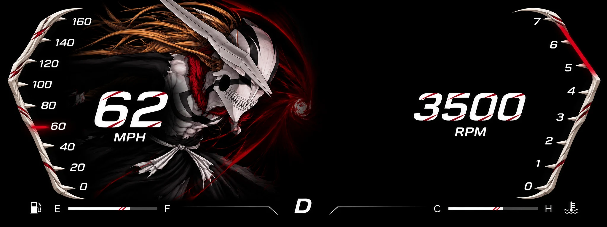

# Bleach Cluster

Hollow Mask is the first design concept for this standalone BMW G30 cluster project.

Ichigo's mask enters the MPH area from the center. Crimson slashes run through the speed and RPM numerals, while bone-white ridges and fang-shaped ticks frame both gauges. Smaller crimson inlays carry the same design into the fuel and temperature bars.

This repository currently contains a static design preview. The displayed values are illustrative. An installable MGU Store app has yet to be built and tested.
